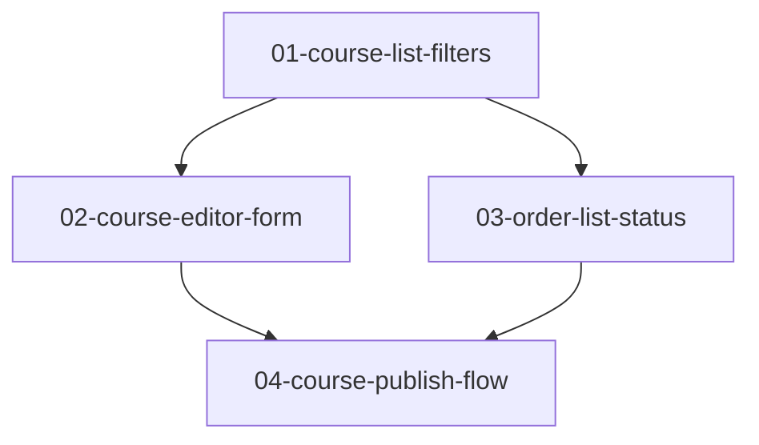

# Epic Schema（共用內容）

> 此文件定義 `epic.md`、`breakdown.md`、`status.json` 三份檔案的格式。供 `discuss-epic`、`breakdown-epic`、`run-epic`、`list-epics`、`archive-epic` 共用。

## 1. `epic.md`（業務目標層）

由 `discuss-epic` 產出，內容是「**為什麼做、做什麼**」（不含技術細節）。

```markdown
# Epic: <epic-id>

## 業務目標

<一段話描述目標，2-3 句>

## 動機

- 業務需求：<...>
- 時間壓力：<deadline 若有>
- 其他：<...>

## User Stories（高層）

> 高層 user story，不細到 acceptance level。各 child change 的 spec.md 才寫細的。

- US-1: <角色> 可以 <做什麼> 達成 <目的>
- US-2: ...
- US-3: ...

## 整體驗收標準

> 跨 module 的整體驗收，單一 module 的驗收放各 change 的 spec.md。

- [ ] 所有 N 個 module 上線
- [ ] 跨模組整合測試通過
- [ ] <業務指標達成>

## 範圍

### 包含

- <高層項目，不細>

### 不包含（Out of Scope）

- <明確劃出去的部分>

## 涉及模組

- <module-1>: 預期是 new 還是 upgrade
- <module-2>: ...

## 預估規模

- 預計 change 數：N
- 預估總時間：M 小時
- 風險等級：低 / 中 / 高
```

## 2. `breakdown.md`（拆解 + 依賴）

由 `breakdown-epic` 產出。AI 自動分析 epic.md 與既有程式碼，拆出 N 個 change 並產生依賴 DAG。

````markdown
# Breakdown: <epic-id>

## 依賴圖



## Change 清單

### 1. course-list-filters

- **模組**: courses
- **mode**: upgrade
- **依賴**: 無
- **預估**: 2-3 hours
- **範圍**: 課程列表篩選、排序、分頁 query state 與外部 API params 對齊
- **change_id**: _(由 /run-epic 執行時產生)_
- **theory**: 為什麼這個排第一 — 列表查詢狀態是後續編輯與上架流程的入口

### 2. course-editor-form

- **模組**: courses
- **mode**: upgrade
- **依賴**: #1
- **parallel_group**: 2
- **預估**: 3-4 hours
- **範圍**: 課程編輯表單、欄位驗證、儲存 loading/error 狀態與 API payload 對齊
- **change_id**: _(待產生)_
- **theory**: 編輯表單依賴列表入口與課程 ID 對應，必須在列表查詢狀態穩定後處理

...
````

**用戶可手動編輯** breakdown.md 調整順序、刪除某個 change、改範圍。AI 在 `/run-epic` 啟動時會以 breakdown.md 為準。

### `parallel_group` 欄位（平行模式專用）

供 `/run-epic --parallel` 用，標記哪些 change 可以同 wave 平行跑。

| 規則 | 說明 |
|---|---|
| 同 group 號 | 同 wave 內平行跑（共用 worktree 隔離） |
| 不同 group 號 | 不同 wave，小號先跑、大號後跑 |
| `depends_on` 必須指向更小 group 的 change | 違反會被 `/run-epic --parallel` 前置檢查拒絕 |
| 未標 `parallel_group` | fallback 為 `index`（等於全序列） |

範例（7 個 change，5 個 wave）：

```yaml
C1: parallel_group=1, depends_on=[]       # Wave 1
C4: parallel_group=1, depends_on=[]       # Wave 1（與 C1 同 wave，平行）
C2: parallel_group=2, depends_on=[1]      # Wave 2
C3: parallel_group=3, depends_on=[]       # Wave 3（無依賴但跟前面 change 改同檔案，故序列）
C5: parallel_group=4, depends_on=[3]      # Wave 4
C6: parallel_group=4, depends_on=[]       # Wave 4（與 C5 同 wave）
C7: parallel_group=5, depends_on=[1, 2]   # Wave 5
```

**設計準則**（給 `breakdown-epic` 與 user）：

- 不只看 `depends_on`，要看「**會不會改到同檔案**」
- 兩個 change 改同檔案 → 不可同 wave（merge 一定 conflict）
- 兩個 change 改同一 route/page/component、shared type 或 API helper → 不可同 wave，除非已確認修改範圍不重疊
- 衝突檔案無法判斷時，保守起見放不同 wave

## 3. `status.json`（執行時狀態）

由 `breakdown-epic` 初始化、`run-epic` 與 `archive-change` 持續更新。

```json
{
  "epic_id": "2026-05-course-admin",
  "title": "改善課程管理後台流程",
  "execution_mode": "interactive",
  "epic_status": "running",
  "current_change_index": 2,
  "total_changes": 4,
  "created_at": "2026-05-04T10:00:00+08:00",
  "updated_at": "2026-05-04T13:30:00+08:00",
  "changes": [
    {
      "index": 1,
      "title": "course-list-filters",
      "module": "courses",
      "mode": "upgrade",
      "depends_on": [],
      "parallel_group": 1,
      "status": "done",
      "change_id": "2026-05-04-course-list-filters",
      "started_at": "2026-05-04T10:15:00+08:00",
      "ended_at": "2026-05-04T12:30:00+08:00"
    },
    {
      "index": 2,
      "title": "course-editor-form",
      "module": "courses",
      "mode": "upgrade",
      "depends_on": [1],
      "parallel_group": 2,
      "status": "in_progress",
      "change_id": "2026-05-04-course-editor-form",
      "started_at": "2026-05-04T12:45:00+08:00"
    },
    {
      "index": 3,
      "title": "order-list-status",
      "module": "orders",
      "mode": "upgrade",
      "depends_on": [2],
      "parallel_group": 3,
      "status": "pending",
      "change_id": null
    },
    {
      "index": 4,
      "title": "course-publish-flow",
      "module": "courses",
      "mode": "upgrade",
      "depends_on": [3],
      "parallel_group": 4,
      "status": "pending",
      "change_id": null
    }
  ],
  "errors": []
}
```

### 欄位定義

#### 頂層

| 欄位 | 型別 | 說明 |
|---|---|---|
| `epic_id` | string | 等同目錄名 `<YYYY-MM-slug>` |
| `title` | string | 業務目標的簡短標題 |
| `execution_mode` | enum | `interactive` / `yolo` |
| `epic_status` | enum | `discussing` / `ready` / `running` / `paused` / `done` / `archived` |
| `current_change_index` | int | 目前進行到第幾個 change（1 起算） |
| `total_changes` | int | 總共幾個 change |
| `created_at` / `updated_at` | ISO8601 | 時間戳 |
| `changes` | array | 各 child change 子物件，見下 |
| `errors` | array | 失敗紀錄 |

#### `changes[]` 元素

| 欄位 | 型別 | 說明 |
|---|---|---|
| `index` | int | 1 起算的順序 |
| `title` | string | breakdown 的 slug |
| `module` | string | 對應 `docs/features/{module}/` |
| `mode` | enum | `new` / `upgrade` |
| `depends_on` | array of int | 依賴哪幾個 index |
| `parallel_group` | int \| null | 平行模式專用，同號可同 wave 平行；缺值時 fallback 為 `index` |
| `status` | enum | `pending` / `in_progress` / `done` / `failed` / `blocked` / `skipped` |
| `change_id` | string \| null | 對應 `docs/changes/<id>/`（in_progress 之後才有） |
| `started_at` / `ended_at` | ISO8601 | 該 change 的時間戳 |

## 4. Child Change 的 spec.md 反向連結

`/run-epic` 為每個 child change 建立 `docs/changes/<change-id>/spec.md` 時，必須在頂部加入：

```markdown
# Change Spec: <change-id>

## Parent Epic

**epic_id**: <epic-id>
**parent_path**: docs/epics/<epic-id>/
**index_in_epic**: <1-based int>

## 目標模組
...
```

這讓 child change 知道自己屬於哪個 epic（給後續 `/archive-change` 等 skill 用來更新 epic status）。
