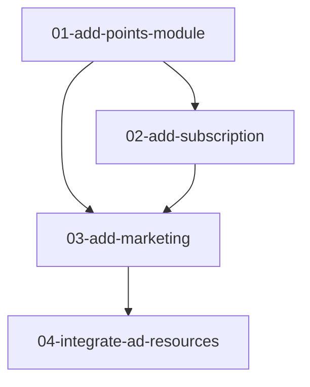

## 功能需求

$ARGUMENTS

讀取 active epic 的 `epic.md`，AI 自動分析並拆解為 N 個 child change，產生 `breakdown.md`（含依賴 DAG）與初始化 `status.json`。

## 前置檢查

### 檢查 1：取得 active epic

讀取 `docs/epics/_active.md`，取得 `active_epic_id`。若為 `(none)`，拒絕並提示先 `/discuss-epic`。

### 檢查 2：確認狀態

讀取 `docs/epics/<id>/status.json`，確認 `epic_status` 為 `discussing` 或 `ready`：

- `discussing`（剛從 discuss-epic 過來）：可拆解
- `ready`（已拆過）：詢問用戶要重拆還是 abort
- `running` / `paused`：拒絕（用 `/run-epic` 接續）
- `done` / `archived`：拒絕

### 檢查 3：讀必要資訊

1. `docs/epics/<id>/epic.md` - **主要依據**
2. 列出 `docs/features/` 下所有既有模組（用於判斷 mode = new / upgrade）
3. **快速掃描**（不深讀） `src/` 結構，確認模組路徑與依賴脈絡

## 拆解流程

扮演資深技術主管，分析 epic 並做出 4 個判斷：

### Step 1：識別涉及模組

從 epic.md 的「涉及模組」章節提取，再驗證：

- 該模組是否已存在於 `docs/features/{module}/` → mode: upgrade
- 不存在 → mode: new
- 補上 epic.md 沒提到但實際需要的模組（例：「訂閱」隱含需要「user」的擴充）

### Step 2：拆出 N 個 atomic change

原則：

- ✅ 每個 change **限定單一模組**（不跨多 module）
- ✅ 每個 change 大小 **2-5 hours** 等級（太大要拆，太小要合）
- ✅ 命名清楚：`<verb>-<module>-<scope>` 例：`add-points-module`、`upgrade-user-with-subscription-fields`
- ❌ 不要拆出「文件」這種非實作的 change
- ❌ 不要把 review/test 拆出來（每個 change 內部已有 review/test 階段）

### Step 3：分析依賴

對每個 change 標記 `depends_on`：

- A 先建立共享 route / layout / page 結構，B 才能掛上入口或子頁 → B depends on A
- A 先定義 shared component、hook、type 或 API contract，B 才能重用或串接 → B depends on A
- A 與 B 會修改同一個 route、layout、component、type 或 API adapter，需標記衝突風險並避免放在同一個 parallel_group
- 純獨立的 change → depends_on 為空

產生依賴 DAG（mermaid graph 格式），並在可平行時優先確認是否存在共享檔案衝突。

### Step 4：拓撲排序

依賴從少到多排序：

1. 無依賴的先（基礎入口或共享基礎，例：course-list-route、shared-course-types）
2. 依賴 #1 的次之（例：course-filter-panel 依賴列表 route 與 query state）
3. 依賴 #2 的再次（例：course-editor-form 依賴 shared type 與 API payload 對齊）
4. 最後是整合層（例：course-publish-flow 串接列表、表單、權限與 API 狀態）

若有並行可能（A、B 都只依賴 #1），仍需先確認是否會修改同一個 route、layout、component、type 或 API adapter；沒有衝突才按重要性或名稱排序。

## 產出

### 寫 `docs/epics/<id>/breakdown.md`

依 [`../_references/epic-schema.md`](../_references/epic-schema.md) 的 `breakdown.md` 格式：

````markdown
# Breakdown: <epic-id>

## 依賴圖



## Change 清單

### 1. add-points-module
...
````

### 更新 `docs/epics/<id>/status.json`

把 `changes[]` 填入拆解結果，每個 child change 的 `status: "pending"`、`change_id: null`。
頂層 `epic_status` 改為 `ready`、`total_changes` 設為 N。

### 更新 `docs/epics/_active.md`

加上 `total_changes` 與 `current_change_index: 0`。

## 確認階段

寫完後，**顯示 breakdown 摘要給用戶**：

```
─────────────────────────────────────────────────────────
📊 Epic 拆解完成：<epic-id>

拆出 <N> 個 change：

  1. add-points-module          (points, new)        2-3h
  2. add-subscription           (subscription, new)  3-4h    依賴 #1
  3. add-marketing-campaigns    (marketing, new)     2-3h    依賴 #1, #2
  4. integrate-ad-resources     (ad-resources, new)  3h      依賴 #3

📐 依賴圖（mermaid）：
  <ASCII 簡圖>

⏱️ 預估總時間：<sum> hours

📁 詳細：docs/epics/<epic-id>/breakdown.md

─────────────────────────────────────────────────────────

請選擇：
  [c] continue — 直接執行 /run-epic 開始跑
  [e] edit     — 我手動編輯 breakdown.md 再 /run-epic（你可重排順序、刪 change、改範圍）
  [a] abort    — 取消（保留 epic 與 breakdown，但不執行）
```

依用戶選擇：

- `[c]`：執行 `/run-epic`（預設 interactive 模式，問用戶要不要 yolo）
- `[e]`：回應「請編輯 docs/epics/<id>/breakdown.md，完成後執行 /run-epic」
- `[a]`：保留 breakdown 不執行

## 重要規範

- ✅ 拆解時要看既有 `docs/features/` 確認 mode（new vs upgrade）
- ✅ 每個 change atomic（單模組、2-5 小時級）
- ✅ 嚴格拓撲排序
- ❌ 不要建立 child change 的 spec.md（那是 `/run-epic` 的工作）
- ❌ 不要動 `docs/changes/`（這個 skill 只動 `docs/epics/<id>/`）
