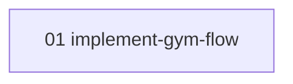

# Breakdown: 2026-11-pokemon-gym-upgrade

## 依賴圖

## Change 清單

### 1. implement-gym-flow

- **模組**: gym
- **mode**: upgrade
- **依賴**: 無
- **範圍**: 在升級分支實作新版核心流程，並驗證玩家能在手機上從查詢走到結果。
- **change_id**: _(由執行流程產生)_
- **theory**: 將確認過的規格、介面與架構方案做成可操作的玩家流程。
- **啟動條件**: 執行前確認 [升級待辦](../../../todo.md) 的 03 手機 UI/UX 與 04 架構與遷移方案已交付。它們是人工確認的前置條件。
